# 流程設計與一次真實執行紀錄

## 一、流程圖

文字版：

1. **取得資料**：把來源擷取成 `raw/`（只新增不修改），每篇 ingest 前先和使用者討論。
2. **查詢 Wiki**：先讀 `index.md` 找相關頁，再讀概念頁。
3. **整理重點**：把每個概念頁整理成投影片稿（`draft_vN.json`），每條句尾標 `[S#]`，並記下引用的 Wiki 頁。
4. **檢查 A（內容，產生之前）**：不通過就回到步驟 3；若是 Wiki 本身沒有的內容，回到步驟 1 重新 ingest，不可以直接寫進簡報。
5. **產生簡報 HTML**：由稿件用腳本產生，每頁頁尾放引用的 Wiki 頁連結。
6. **檢查 B（成品）**：不通過就回到步驟 5。
7. **發佈**：簡報與 Wiki 網頁版放上 GitHub Pages。

### 哪些步驟會重複、為什麼
- **3 ↔ 4（整理—檢查 A）**：內容錯誤的修法是改稿件，成本最低，所以在產生 HTML 之前就攔下來。重複到檢查 A 沒有問題為止。
- **5 ↔ 6（產生—檢查 B）**：檢查 B 看的是 A 看不到的東西（版面、連結、頁尾），所以另外檢查。
- 兩個檢查分開的原因：A 檢查「說的對不對」，B 檢查「呈現對不對」。內容還沒對就先排版，修正後版面又要重做。

### 檢查項目
| 檢查 | 項目 | 方式 |
|---|---|---|
| A | 每條句尾有 `[S#]`；標記出現在所引用的 Wiki 頁 | `check_a.py` |
| A | 句中數字都出現在所引用的 Wiki 頁 | `check_a.py` |
| A | 不含 raw 標示【擷取備註】的內容（延後回饋） | `check_a.py` |
| A2 | 與 Wiki 最接近一句的字元重疊率偏低者列出，人工判斷 | `check_a2.py`（實跑後新增） |
| A | 人工通讀：有沒有把來源說的範圍講大 | 人工 |
| B | 每頁頁尾有 Wiki 引用、連結都指到存在的檔案 | `check_b.py` |
| B | 內容與頁尾不重疊、手機與桌機都不跑版 | `check_b.py` |
| B | 簡報文字與稿件一致 | `check_b.py` |
| B | 看截圖 | 人工 |

## 二、一次真實執行（2026-11-23）

**步驟 1–2**：讀 `index.md`，6 個概念頁、5 個來源頁。

**步驟 3**：整理出第一版 `draft_v1.json`：14 頁、49 條。

**步驟 4 檢查 A（第一輪）**：`check_a.py` 報 4 個問題（`check-a-v1.txt`）
- 第 1 頁：那一條沒有 `[S#]`，而且「5 篇」這個數字不在任何 Wiki 概念頁。
- 第 5 頁：「有意義的內容通常忘得比較慢，大約慢 2 到 3 倍」，數字 2、3 不在 Wiki。這一條是我自己補的，來源沒有這個數字，而且 Wiki 的遺忘曲線頁明確寫了「不寫具體差距」。

人工通讀再找到 4 條（腳本抓不到，因為有標記、也沒有新數字，但把來源講大了）：
- 第 3 頁：「畫重點對跨概念推論的理解沒有幫助」。Wiki 是「與單純閱讀相比並未帶來幫助；一項研究中……表現較差」，我把一項研究講成一般結論。
- 第 14 頁：「覺得比較費力，往往是方法有效的訊號」。Wiki 沒有這個結論。
- 第 2 頁：illusion of learning 的敘述和 Wiki 的措辭不同。
- 第 12 頁：10–20% 的說法比 Wiki 少了「距離需要用到這個資訊的時間」這個基準。

**回到步驟 3**：修改成 `draft_v2.json`。第 5 頁改成「來源沒有提供……所以不寫具體差距」；第 14 頁改成 Wiki 原有的兩句；其餘照 Wiki 措辭改回。

**檢查 A（第二輪）**：`check_a.py` 0 個問題。

**事後補做的檢查 A2**：對 v1 跑貼近度檢查，「2 到 3 倍」那一條排第 3 低（0.26），「往往是方法有效的訊號」排第 6 低（0.40）。對 v2 跑，最低的是第 14 頁的總結句（0.18、0.19），人工看過，是把前面幾頁的結論合併成一句，保留。

**步驟 5**：由 `draft_v2.json` 產生 `slides/index.html`；另產生 Wiki 的網頁版。

**步驟 6 檢查 B（第一輪）**：`check_b.py` 0 個問題。但人工看截圖發現：
- 第 4 頁的示意圖，「複習後曲線變平」的文字壓在曲線上。
- 圖說離圖太遠，掉在版面下方。

腳本沒有抓到，因為它只量區塊的位置，不看 SVG 裡面文字有沒有壓線。

**回到步驟 5**：把圖例文字移到曲線上方、把圖和圖說包在同一個區塊。

**檢查 B（第二輪）**：腳本 0 個問題，截圖確認文字不再壓線、圖說緊接在圖下方。

## 三、反思

**最容易出錯的節點：步驟 3「整理重點」。** 第一版 49 條裡有 8 條有問題，全部出在這個節點。最嚴重的是第 5 頁的「慢 2 到 3 倍」：這正好是你之前問過的「有意義的內容遺忘速度是否不同」，我把它寫成簡報時，順手補了一個來源沒有的數字。Wiki 當時已經寫明不寫具體差距，但整理成簡報句子時還是漏出去了。越是想讓內容「完整、好懂」，越容易補進來源沒有的東西。

**把檢查提前到哪裡：** 內容檢查放在「產生 HTML 之前」，檢查對象是稿件 JSON，不是成品。這次 8 個內容問題都在產生 HTML 之前被擋下，沒有一個進到成品。如果等到簡報做完才查，同一個錯要同時改稿件、重產生 HTML、重看版面。

**實跑之後修改了流程：**
1. 新增檢查 A2（貼近度）。原因是檢查 A 只看「有沒有標記、數字在不在」，抓不到「有標記但把範圍講大」的句子。A2 在 v1 抓到 2 條有問題的，但對總結頁會誤報（總結本來就是合併句），所以只用來列出候選，由人工判斷，並不是自動通過或失敗。門檻是我自己抓的，沒有調整過。
2. 檢查 B 把「看截圖」列為必做。原因是這次腳本 0 個問題，截圖卻看到兩個版面問題。

**還沒解決的：** `check_b.py` 仍然抓不到 SVG 內部的文字重疊。A2 的字元重疊率也只是粗略指標，改寫過但意思正確的句子可能分數偏低。
